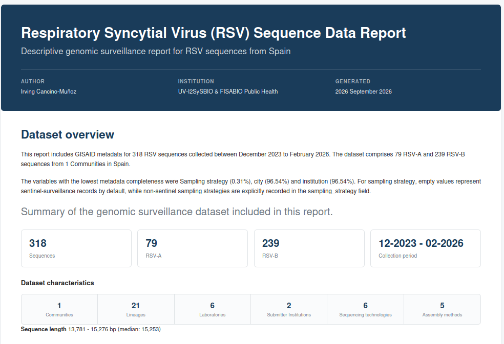
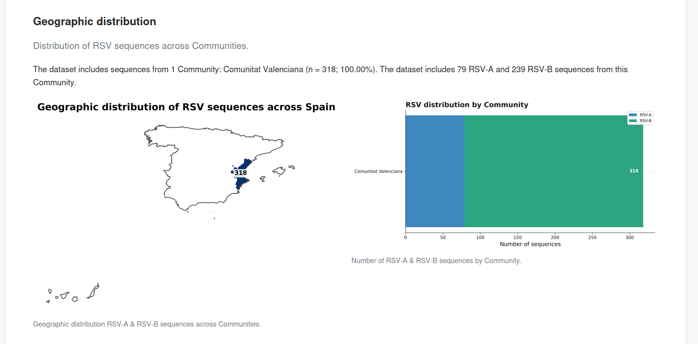

# GenomeReport

**GenomeReport** is a Python software tool for generating automated descriptive reports from genomic surveillance data. It was originally developed for reporting **Respiratory Syncytial Virus (RSV)** genomic surveillance datasets based on GISAID metadata and upstream genomic analyses.

GenomeReport transforms processed genomic surveillance data into a structured report containing summary statistics, tables, and publication-ready visualizations. The generated report provides an overview of the dataset across epidemiological, laboratory, sequencing, viral diversity, protein variation, and genomic clustering dimensions.

GenomeReport is part of a broader bioinformatics workflow developed for the analysis of RSV genomic surveillance datasets using metadata and viral genome sequences obtained from **GISAID**. Within this workflow, GenomeReport provides the reporting layer, transforming processed metadata and genomic analysis results into a standardized and reproducible report. The input dataset is expected to contain metadata and genomic analysis results generated during the upstream stages of the RSV genomic surveillance pipeline, including metadata obtained from GISAID.

The software is designed to facilitate routine exploration and reporting of genomic surveillance datasets while keeping the analysis descriptive and reproducible.

## Features

GenomeReport automatically generates:

- **Dataset overview** — general composition and completeness of the dataset.
- **Geographic and temporal distribution** — temporal distribution of sequences and geographic representation across Spanish  Communities, including map-based visualization.
- **Patient characteristics** — available demographic and clinical metadata.
- **Laboratory contribution** — contribution of submitting and originating laboratories.
- **Sequencing characteristics** — sequencing technologies, assembly methods, genome coverage, and related metadata.
- **Virus diversity** — subtype, lineage, and genotype composition and their temporal distribution.
- **Protein variation** — amino acid substitutions, mutation burden, and protein-level variation.
- **Genomic clustering** — descriptive summaries of genomic clusters based on SNP-distance thresholds.
- **Phylogeny integration** — optional inclusion of one or more externally generated phylogenetic figures.

The analysis produces a self-contained interactive HTML report together with the corresponding summary tables and figures.

## Installation

Clone the repository and install GenomeReport in editable mode:

```bash
git clone https://github.com/irvink182/GenomeReport.git
cd GenomeReport
pip install -e .
```

Verify the installation:

```bash
genomereport --help
```

## Usage

### 1. Generate an HTML report
```bash
genomereport metadata.tsv \
    --output results \
```
### 2. Include one phylogenetic figure.
```bash
genomereport metadata.tsv \
    --output results \
    --phylogeny phylogeny_figure.png
```

### 3. Include multiple phylogenetic figures.
```bash
genomereport metadata.tsv \
    --output results \
    --phylogeny phylogeny_figure_1.png phylogeny_figure_2.png
```
## Input data

GenomeReport takes a tabular genomic surveillance dataset as input. Each row represents a viral genome sequence and its associated metadata, while columns contain epidemiological, laboratory, sequencing, genomic, and mutation-related information.

The input dataset is expected to contain metadata and genomic analysis results generated during the upstream stages of the RSV genomic surveillance pipeline, which is based on GISAID available metadata.

GenomeReport is designed to work with partially populated datasets. When data required for a specific analysis are not available, the corresponding analysis or report component is omitted where applicable.

### Input variables

The dataset can contain information from the following categories:

| Category | Variables | Description |
|---|---|---|
| Sequence | `Accession ID`, `Subtype` | Sequence identifier and RSV subtype |
| Temporal | `Collection date` | Sample collection date used for temporal summaries |
| Geographic | `Location`, `autonomous_community`, `city` | Geographic origin of the sequences, including Community-level data used for geographic visualization |
| Surveillance | `Sampling strategy` | Sampling or surveillance strategy |
| Laboratory | `institution`, `originating_lab`, `submitter_lab_name` | Institutions and laboratories associated with sequence generation and submission |
| Sequencing | `Sequence Length`, `Sequencing technology`, `Assembly method` | Sequencing and genome assembly information |
| Virus classification | `Lineage`, `Genotype` | RSV lineage and genotype assignments |
| Patient | `Host`, `Gender`, `Patient age`, `Patient status` | Available host and patient metadata |
| Protein variation | `AA Substitutions` | Amino acid substitutions identified in each genome |
| Genomic clustering | `Cluster_*` | Genomic cluster assignments at the available SNP-distance thresholds |

### Metadata normalization

GenomeReport includes normalization procedures for several metadata fields to harmonize heterogeneous values commonly found in genomic surveillance datasets.

Currently, normalization is applied to variables including:

- patient age and age units;
- patient gender;
- patient status;
- sequencing technology;
- genome assembly method;
- sampling strategy.

Missing or unavailable metadata are also standardized during data processing. GenomeReport recognizes common representations of missing data, including empty values, `NA`, `N/A`, `UNKNOWN`, `NOT AVAILABLE`, `NONE`, and `NULL`.


## Output

GenomeReport generates a structured output directory containing the interactive HTML report, a text summary, the figures used in the report, and the corresponding summary tables.

A typical output directory has the following structure:

```text
results/
├── report.html
├── report_summary.txt
├── figures/
│   ├── clusters/
│   ├── geography/
│   ├── laboratory/
│   ├── mutations/
│   ├── overview/
│   ├── patient/
│   ├── phylogeny/
│   ├── sequencing/
│   └── virus/
└── tables/
    ├── clusters/
    ├── geography/
    ├── laboratory/
    ├── mutations/
    ├── overview/
    ├── patient/
    ├── sequencing/
    └── virus/
```
### HTML report

`report.html` is the main output of GenomeReport. It provides a self-contained interactive report organized into thematic sections covering the different dimensions of the genomic surveillance dataset.

Depending on the data available, the report can include:

- Dataset overview
- Geographic and temporal distribution
- Patient characteristics
- Laboratory contribution
- Sequencing characteristics
- Virus diversity
- Protein variation
- Genomic clustering
- Phylogenetic figure

Report components for which suitable data are not available are omitted where applicable.

### Figures

Figures generated during the analysis are organized by report section under the `figures/` directory. This includes geographic maps, temporal distributions, categorical summaries, lineage and genotype dynamics, protein variation visualizations, and genomic clustering figures.

Figures are exported in both PNG and SVG formats at publication-quality resolution.

### Tables

The `tables/` directory contains the summary tables underlying the descriptive analyses and visualizations included in the report. Tables are organized by report section and exported in TSV format, allowing the results to be inspected or reused independently of the HTML report.


### Text summary
`report_summary.txt` provides a text-based summary of the dataset and the main descriptive results generated during the analysis.


## Report preview

GenomeReport generates a self-contained interactive HTML report combining summary metrics, descriptive text, tables, and visualizations.



Geographic surveillance data are also represented using Autonomous Community-level maps of Spain.

